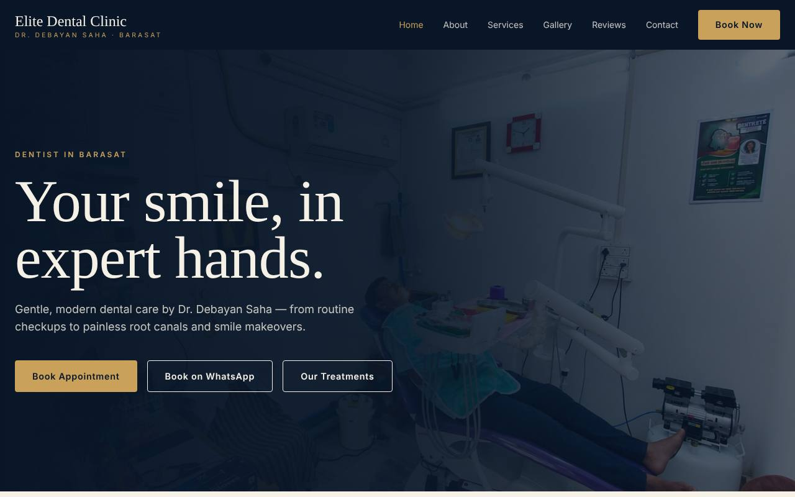
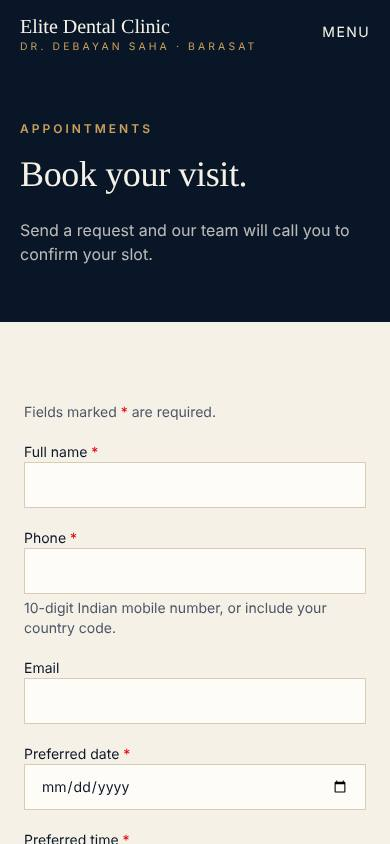

# Elite Dental Clinic — Barasat

Website and online booking system for Dr. Debayan Saha's dental clinic in Barasat, West Bengal — **https://drdebayansaha.in**

Patients can browse treatments, see clinic photos and before/after cases, find the clinic, and request an appointment online (timezone-aware, `Asia/Kolkata`) or via WhatsApp. Clinic staff manage requests in a private dashboard.

| Home                                            | Booking (mobile)                                               |
| ----------------------------------------------- | -------------------------------------------------------------- |
|  |  |

More: [Services](docs/screenshots/services-desktop.jpg) · [Gallery](docs/screenshots/gallery-desktop.jpg) · [Booking (desktop)](docs/screenshots/booking-desktop.jpg) · [Home (mobile)](docs/screenshots/home-mobile.jpg)

## Highlights

- **A booking is never lost.** The appointment and its email job are saved in one database transaction; if email fails, the job is kept with a retry schedule (2 min to 2 h backoff, 5 attempts) and staff can also resend from the dashboard. Automatic retries need the scheduler described in [docs/DEPLOYMENT.md](docs/DEPLOYMENT.md) (a Cloudflare Cron Trigger, configured in the build but only confirmed once deployed); until it runs, staff can resend from the dashboard.
- **Spam-resistant without annoying patients.** Honeypot field, Cloudflare Turnstile and rate limiting.
- **Private by design.** The public can't read or write the database directly; patient notes stay out of emails; consent is collected.
- **Staff dashboard.** Search, filter, status tracking and notification status, behind server-verified login.
- **Measured.** Google Analytics 4 tracks the visitor-to-booking funnel (call, WhatsApp, directions, book click, submit).
- **Tested at three levels.** Unit/component tests, real-PostgreSQL integration tests, and browser tests. See [docs/TESTING.md](docs/TESTING.md).

**Why it's built this way:** [docs/DESIGN-DECISIONS.md](docs/DESIGN-DECISIONS.md)

---

## Technical Stack

- **Framework**: TanStack Start (React 19, TypeScript, file-based routing, server functions, SSR)
- **Styling**: Tailwind CSS v4
- **Database**: Supabase (PostgreSQL) — Row Level Security strictly enforced; public direct client access revoked; trusted writes via server-only `service_role`
- **Email Notifications**: Resend — Transactional clinic alerts backed by a durable notification outbox with exponential-backoff retry (needs the scheduler from docs/DEPLOYMENT.md)
- **Validation**: Zod — Shared single-source-of-truth validation for client forms and server endpoints
- **State Management**: TanStack Query (mutations) & Supabase Auth (staff administration)
- **Testing**: three layers, described honestly in [docs/TESTING.md](docs/TESTING.md): Vitest + React Testing Library unit/component tests with mocked services (`npm test`), real-PostgreSQL integration tests that apply the migrations (`npm run test:integration`), and Playwright browser tests (`npm run test:e2e`)

---

## Getting Started

```sh
cp .env.example .env     # Fill in environment secrets (see docs/ENVIRONMENT.md)
npm install              # Install dependencies
npm run dev              # Start local development server
```

### Available Scripts

| Script                     | Purpose                                                                                                                                   |
| -------------------------- | ----------------------------------------------------------------------------------------------------------------------------------------- |
| `npm run dev`              | Start development server with HMR                                                                                                         |
| `npm run build`            | Compile client assets and SSR worker bundle                                                                                               |
| `npm run preview`          | Preview production build locally                                                                                                          |
| `npm run typecheck`        | Run TypeScript type checks (`tsc --noEmit`)                                                                                               |
| `npm run lint`             | Run ESLint across codebase                                                                                                                |
| `npm run format`           | Format code with Prettier                                                                                                                 |
| `npm test`                 | Run the Vitest unit/component suite (mocked services, no database needed)                                                                 |
| `npm run test:integration` | Apply the migrations to a real PostgreSQL (`TEST_DATABASE_URL`, db name must contain `test`) and test permissions, RPCs and rate limiting |
| `npm run test:e2e`         | Playwright browser tests (Chromium). One-time: `npx playwright install chromium`                                                          |

---

## Project Structure

```text
src/
├── routes/            THIN file-based routes (URLs, SEO, composition) + /api endpoints
├── features/          One folder per domain: components/ hooks/ api/ server/ data/ schemas
│   ├── appointments/  Booking form, validation, create-appointment + notification outbox
│   ├── admin/         Staff portal: dashboard, login, session, admin API + server modules
│   ├── clinic/        Services, reviews, photos (data + cards)
│   └── home/ about/   Page sections
├── components/        Reusable UI: layout/ forms/ feedback/
├── hooks/             Reusable hooks (debounce, disclosure)
├── api/               Browser HTTP client, response types, endpoint registry
├── server/            Shared server plumbing: http/ (handler wrapper, rate limit, secrets) services/
├── config/            site.ts (clinic facts), env.public.ts, env.server.ts (all env access)
├── integrations/      Generated Supabase client and types (do not edit)
├── lib/               errors, logger, analytics, seo, sitemap, query-client
└── test/              Setup, routing/SEO tests, DB integration tests
```

Comprehensive documentation:

- **[docs/DESIGN-DECISIONS.md](docs/DESIGN-DECISIONS.md)**: Why each major choice was made, what was rejected, and known limitations.
- **[docs/ARCHITECTURE.md](docs/ARCHITECTURE.md)**: Architectural layers, outbox pattern, and security model.
- **[docs/API.md](docs/API.md)**: Complete HTTP API contract, request/response formats, and error codes.
- **[docs/ENVIRONMENT.md](docs/ENVIRONMENT.md)**: Detailed environment variable guide and failure behaviors.
- **[docs/TESTING.md](docs/TESTING.md)**: What each test layer proves, how to run it, and the recorded verification history.
- **[docs/DEPLOYMENT.md](docs/DEPLOYMENT.md)**: Required migrations, live verification steps, and what the hosting platform must provide.

---

## Staff Admin Portal

Clinic staff can securely access the administrative dashboard at `/admin`:

- **Authentication**: Staff accounts are provisioned in the Supabase Dashboard under Authentication.
- **Features**: View paginated appointment requests, search by patient name/phone, filter by status, update statuses (`called`, `confirmed`, `visited`, `completed`, `no_show`, `cancelled`), and view notification delivery outbox states.
- **Notification Outbox Recovery**: Process pending or failed email retries on-demand with one click.
- **Security**: All dashboard data access and mutations are protected by server-side JWT verification; public access is denied with HTTP 401.

---

## SEO & Technical Standards

- **JSON-LD Structured Data**: Emits schema.org `Dentist` and `LocalBusiness` structured data including clinic coordinates, opening hours, and verified details.
- **Canonical URLs**: Automatically generated for all public pages on the confirmed production origin (`https://drdebayansaha.in`).
- **Sitemap & Robots**: `/sitemap.xml` and `/robots.txt` generated dynamically. Private `/admin/` and `/api/` endpoints are explicitly disallowed from indexing.
- **Zero Secrets**: Secrets (`SUPABASE_SERVICE_ROLE_KEY`, `RESEND_API_KEY`, `NOTIFY_SECRET`) are never bundled into client-side code.
